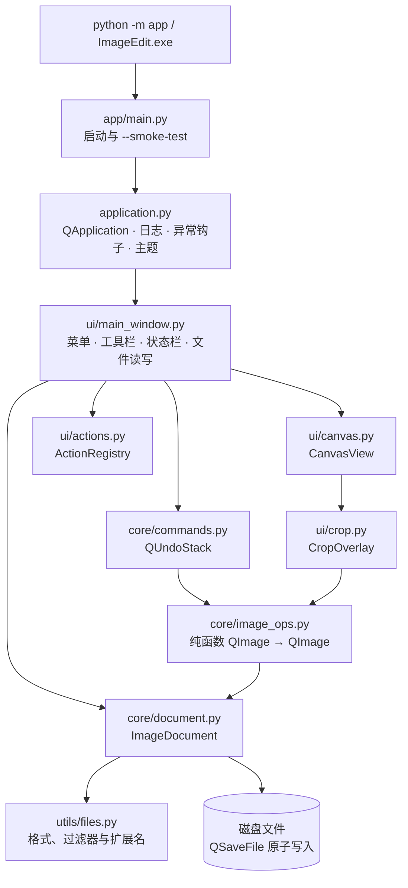

# image-edit

[](https://github.com/Rylin512/image-edit/actions/workflows/ci.yml)


**基于 Python 与 PySide6 的桌面图片编辑器**：平滑缩放平移、旋转镜像、自由与比例裁剪、可撤销的编辑流水线，以及一键打包的 Windows 便携版与安装包。

image-edit 把「读图 → 编辑 → 保存」做成一个可直接交付的桌面程序。核心图像操作是纯粹的 `QImage -> QImage` 函数，界面通过统一的撤销栈把它们串起来；画布只改变换、不重采样像素，因此缩放和平移始终顺滑。新增功能通常只需要写一个纯函数，再挂到菜单或工具栏上。

## 目录

- [项目简介](#项目简介)
- [功能特性](#功能特性)
- [系统架构](#系统架构)
- [快速开始](#快速开始)
- [使用说明](#使用说明)
- [项目结构](#项目结构)
- [扩展指南](#扩展指南)
- [打包与发布](#打包与发布)
- [开发检查与 CI](#开发检查与-ci)
- [常见问题](#常见问题)
- [已知限制](#已知限制)
- [路线图](#路线图)
- [安全说明](#安全说明)
- [贡献](#贡献)
- [许可证](#许可证)

## 项目简介

这是一个「基础扎实、继续长功能」的图片编辑器：

- **能用的编辑器**：打开 PNG / JPEG / BMP / WebP / GIF / TIFF，旋转、镜像、裁剪，原子保存为 PNG / JPEG / WebP / BMP / TIFF。
- **可扩展的骨架**：`core / ui / utils` 分层；图像操作用纯函数表达，撤销、菜单、快捷键、状态栏刷新都由框架代劳。
- **可交付的桌面应用**：`run.bat` 一键建环境并启动；PyInstaller 生成免安装便携版；Inno Setup 生成当前用户安装包；CI 在 Windows 上自动产出 zip 与安装程序。

界面为深色主题，工具栏图标由代码绘制、不依赖外部图标包；窗口大小、工具栏位置与上次打开目录都会被记住。

## 功能特性

| 能力 | 说明 |
|---|---|
| 打开与拖放 | 文件对话框或拖入窗口打开；支持 PNG、JPEG、BMP、WebP、GIF、TIFF |
| 平滑画布 | 滚轮以光标为锚点缓动缩放（1%–3200%），左键或中键拖拽平移，支持适应窗口与 100% |
| 旋转与镜像 | 左右 90°、180°、水平/垂直镜像；90° 整数倍变换不重采样像素 |
| 裁剪 | 自由裁剪与 7 种常用比例；拖动新建、八向控制点缩放、方向键微调、尺寸角标实时显示 |
| 撤销/重做 | 所有编辑进入同一个 `QUndoStack`，最多 20 步；每步只保留「操作前」快照 |
| 方向校正 | 读取时按 EXIF 方向自动旋正，避免手机照片横置 |
| 原子保存 | `QSaveFile` 先写临时文件再提交，写入失败不会破坏原文件；JPEG 质量 92 |
| 未保存保护 | 有未保存修改时，打开新图、拖入文件或关闭窗口前都会询问保存 / 放弃 / 取消 |
| 深色主题 | Fusion + 深色调色板 + QSS；Windows 10/11 同步切换原生深色标题栏 |
| 矢量图标 | 工具栏图标由 `QPainter` 绘制并按 1x/2x/3x 生成，不依赖第三方图标包 |
| 可诊断 | 状态栏显示坐标、尺寸与缩放；滚动日志；未捕获异常弹窗并写入日志 |
| 一键启动与打包 | `run.bat` 自动创建 `.venv` 并安装依赖；打包产物自带 Python 与 Qt |
| 声明式动作 | `ActionRegistry` 统一创建动作并挂到菜单、子菜单与工具栏 |

## 系统架构



### 关键对象

| 对象 | 职责 |
|---|---|
| `ImageDocument` | 持有 `QImage`、路径与脏标记；加载时应用 EXIF 方向，保存时原子写入；发出 `imageChanged / pathChanged / modifiedChanged` |
| `CanvasView` | 显示图片；光标锚点缩放、左/中键平移、打开淡入、拖放高亮；提供裁剪模式与坐标映射 |
| `CropOverlay` | 覆盖在视口上的裁剪选区：拖动新建、移动、八向缩放、比例锁定、尺寸角标与快捷键提示 |
| `image_ops` | 无状态的旋转、镜像、裁剪函数，可直接测试与复用 |
| `ImageOperationCommand` | 把 `QImage -> QImage` 操作变成可撤销命令，只保留一份「操作前」快照 |
| `ActionRegistry` | 创建/登记 `QAction`，声明式挂到菜单、子菜单与工具栏 |
| `MainWindow` | 组装以上对象，负责打开/保存/关闭确认与窗口状态持久化 |

### 设计原则

- **纯函数做变换**：图像操作不碰控件、不读全局状态，输入输出都是 `QImage`；可单测、可复用、可组合。
- **撤销只存一份快照**：命令保留操作前的图像，重做时重新计算，内存约为两张图而不是三张。
- **画布只改变换**：缩放、平移和动画只更新 `QGraphicsPixmapItem` 的浮点变换与透明度，不重建像素。
- **界面与核心解耦**：核心模块不导入窗口；测试在 Qt `offscreen` 平台上无显示器运行。
- **失败可见**：未捕获异常写入日志并弹窗，保存失败给出具体路径，而不是静默退出。

## 快速开始

### 环境要求

| 项目 | 要求 |
|---|---|
| 操作系统 | Windows 10 / 11（推荐；便携版与安装包仅支持 Windows x64）；Linux / macOS 可源码运行 |
| Python | 3.12 及以上（源码模式与打包均需要） |
| 依赖 | PySide6 6.7+（首次启动自动安装，需要联网） |
| 权限 | 普通用户即可，安装包按当前用户安装，无需管理员权限 |

### 方式一：使用打包产物

目前仓库没有发布预编译版本，可以从 CI 获取或本地构建：

1. 打开 Actions 中 `package-windows` 任务，下载 Artifact `image-edit-windows`；
2. 解压 `ImageEdit-portable.zip` 后双击 `ImageEdit.exe`；
3. 或运行 `ImageEdit-Setup-<版本>.exe` 按向导安装，安装后从开始菜单启动。

本地构建方法见[打包与发布](#打包与发布)。

### 方式二：源码运行（免手动部署）

Windows 下双击根目录的 `run.bat`。

- 首次运行会创建 `.venv` 并安装 `requirements.txt` 中的依赖（首次下载 PySide6 需要几分钟）；
- 之后每次启动只比对一次依赖哈希，直接以 `pythonw` 拉起应用，不弹控制台窗口；
- `requirements.txt` 变化时会自动重新安装；
- 启动失败时窗口会暂停并保留错误信息。

常用参数：

```bat
run.bat --console        :: 附带控制台启动，方便看报错
run.bat --prepare-only   :: 只准备虚拟环境，不启动应用
```

### 开发模式

```bash
python -m venv .venv
# Windows: .venv\Scripts\activate
source .venv/bin/activate
pip install -r requirements-dev.txt
python -m app
```

### 第一次编辑

1. 按 `Ctrl+O` 打开图片，或把图片拖进窗口；
2. 滚轮缩放、左键拖动平移；`Ctrl+0` 适应窗口，`Ctrl+1` 回到 100%；
3. 通过「图像」菜单旋转、镜像或裁剪；
4. `Ctrl+S` 保存，`Ctrl+Shift+S` 另存为。

## 使用说明

### 画布交互

| 操作 | 行为 |
|---|---|
| 滚轮 | 以光标位置为锚点缓动缩放，每格约 ×1.2；触控板小增量按比例连续缩放 |
| 左键拖动 | 平移画布（有图片时） |
| 中键拖动 | 平移画布 |
| 拖入文件 | 画布显示虚线高亮，松开后打开 |
| `Ctrl+0` | 适应窗口 |
| `Ctrl+1` | 实际大小（100%） |
| `Ctrl++` / `Ctrl+-` | 放大 / 缩小一档 |

状态栏实时显示光标处的图像像素坐标、图片尺寸与当前缩放百分比。画布隐藏原生滚动条，改用图像项的浮点变换定位，避免缩放动画出现整像素抖动。

### 快捷键

| 功能 | 快捷键 |
|---|---|
| 打开 / 保存 / 另存为 / 退出 | `Ctrl+O` / `Ctrl+S` / `Ctrl+Shift+S` / `Ctrl+Q` |
| 撤销 / 重做 | `Ctrl+Z` / `Ctrl+Y` |
| 向左、向右旋转 90° | `Ctrl+Alt+L` / `Ctrl+Alt+R` |
| 水平、垂直镜像 | `Ctrl+Alt+H` / `Ctrl+Alt+V` |
| 自由裁剪 | `C` |
| 放大 / 缩小 | `Ctrl++` / `Ctrl+-` |
| 实际大小 / 适应窗口 | `Ctrl+1` / `Ctrl+0` |

撤销与重做使用 Qt 的平台标准键位（Linux 上重做通常为 `Ctrl+Shift+Z`）。所有快捷键也可在菜单中看到。

### 编辑能力

- **旋转**：向左/向右 90° 与 180°；使用 90° 整数倍变换，不重采样像素。
- **镜像**：水平、垂直翻转。
- **裁剪**：`图像 → 裁剪` 子菜单集中放「自由裁剪」与常用比例（1:1、4:3、3:4、3:2、2:3、16:9、9:16）；工具栏上自由裁剪按钮右侧有单独的比例下拉按钮。
- **裁剪交互**：进入裁剪会自动适应窗口并显示覆盖层。自由裁剪的初始选区为整张图，比例裁剪的初始选区为居中的最大合规矩形。
  - 在选区内拖动可移动，拖动控制点可缩放；在空白处拖动可新建选区；
  - 比例模式只显示四角控制点，始终保持宽高比；
  - 方向键微调选区（`Shift` 加速），选区左上角显示像素尺寸；
  - `Enter` 或右下角「应用裁剪」确认，`Esc` 或「取消」退出。
- 选区始终被限制在图像范围内；与整图相同或为空的裁剪会被忽略并在状态栏提示。

## 项目结构

```text
image-edit/
├── app/
│   ├── __main__.py          # python -m app / PyInstaller 入口
│   ├── main.py              # 启动流程与 --smoke-test
│   ├── application.py       # QApplication、日志、异常钩子、主题
│   ├── core/
│   │   ├── document.py      # ImageDocument：图片、路径、脏标记、原子保存、EXIF 方向
│   │   ├── commands.py      # QUndoStack 图像操作封装
│   │   └── image_ops.py     # 纯函数：旋转 / 镜像 / 裁剪
│   ├── ui/
│   │   ├── main_window.py   # 菜单、工具栏、状态栏、文件读写、窗口状态
│   │   ├── canvas.py        # QGraphicsView 画布：缩放、平移、动画、坐标、裁剪模式
│   │   ├── crop.py          # 裁剪覆盖层：选区、控制点、比例锁定、应用/取消
│   │   ├── actions.py       # ActionRegistry：声明式动作与菜单注册
│   │   ├── icons.py         # QPainter 绘制的多倍率线性图标
│   │   └── theme.py         # 深色主题、QSS、Windows 深色标题栏
│   ├── utils/
│   │   ├── files.py         # 打开/保存过滤器、格式与扩展名校验
│   │   ├── logging.py       # 1 MB × 3 滚动日志
│   │   └── paths.py         # 应用数据目录、PyInstaller 资源路径
│   └── resources/           # icon.png / icon.ico
├── tests/                   # 64 个测试：文档、命令、图像操作、裁剪、画布、主窗口、启动
├── scripts/
│   ├── launch.py            # run.bat 的引导：虚拟环境、依赖哈希、启动
│   └── make_icon.py         # 生成 PNG 与多尺寸 ICO
├── packaging/
│   ├── image_edit.spec      # PyInstaller onedir 配置
│   ├── build.ps1            # 构建便携版 + 冒烟测试 + zip
│   ├── build_installer.ps1  # 调用 Inno Setup 生成安装包
│   └── installer.iss        # Inno Setup 脚本
├── .github/workflows/ci.yml # lint / test / build / package-windows
├── run.bat                  # Windows 一键启动
├── requirements*.txt
├── pyproject.toml
└── LICENSE
```

## 扩展指南

### 添加一个图像操作

图像操作就是一个纯函数：接收 `QImage`，返回新的 `QImage`。把它交给 `MainWindow.apply_operation` 即可自动入撤销栈、刷新画布与标题。

```python
from PySide6.QtGui import QImage


def invert(image: QImage) -> QImage:
    image.invertPixels()   # 操作拿到的已经是副本
    return image


# 在主窗口里执行
window.apply_operation("反色", invert)
```

约定：

- **必须是纯函数且确定性**：命令只保存操作前快照，重做时会重新调用该函数；
- **不要原地修改共享状态**：虽然传入的是副本，也不要依赖文档对象；
- 失败时抛出异常即可——操作会先被验证，失败不会在撤销栈上留下坏条目。

### 把操作挂到菜单或工具栏

```python
action = window.actions.create(
    "edit.invert",
    "反色(&I)",
    slot=lambda: window.apply_operation("反色", invert),
    shortcut="Ctrl+I",
    status_tip="对当前图片反色",
)
window.actions.add("edit", "edit.invert")          # 追加到「编辑」菜单
window.actions.add_to_toolbar(toolbar, "edit.invert")
```

新动作的启用/禁用状态由功能模块自行维护；内置动作的启用逻辑在 `MainWindow._update_action_states()`。

### 添加画布工具

`CanvasView` 已经隔离好缩放、平移与坐标映射，`ui/crop.py` 是一个完整示例：

- 工具可以是视口子控件（如 `CropOverlay`）或 `QGraphicsItem`；子控件能直接使用普通 `QWidget` 按钮与光标；
- 用 `view_to_image()`、`image_to_view()`、`image_rect()` 在视口与图像坐标之间转换；
- 工具激活时拦截鼠标事件，画布的左键平移就不会启动；
- 完成后仍然通过 `apply_operation` 提交修改，自动获得撤销能力。

### 添加自定义命令

如果操作不是「整图替换」（例如将来的图层增删），直接继承 `QUndoCommand` 并 `push` 到 `window.undo_stack` 即可。

## 打包与发布

打包只支持 Windows x64，需要 Python 3.12+。便携版脚本会在缺少时自行创建 `.venv`，安装包脚本复用同一个环境。

### 便携版（免安装）

```powershell
powershell -ExecutionPolicy Bypass -File packaging\build.ps1
```

产物：

- `dist\ImageEdit\ImageEdit.exe` —— 免安装目录，双击启动；
- `dist\ImageEdit-portable.zip` —— 整个目录压缩，分发时用这个。

构建脚本会安装运行与打包依赖、按需生成图标、运行 PyInstaller（onedir，无控制台窗口），然后执行 `ImageEdit.exe --smoke-test`：启动 300ms 后正常退出，用来确认冻结后的 Qt 能加载。

### 安装包

先安装 [Inno Setup](https://jrsoftware.org/isinfo.php)（只需一次）：

```powershell
winget install -e --id JRSoftware.InnoSetup
```

然后：

```powershell
powershell -ExecutionPolicy Bypass -File packaging\build_installer.ps1
```

产物：`dist\ImageEdit-Setup-<版本>.exe`。

- 版本号从 `app.__version__` 读取，安装包与 `pyproject.toml` 共用同一来源；
- 默认按当前用户安装到 `%LOCALAPPDATA%\Programs\Image Edit`，不需要管理员权限；
- 创建开始菜单快捷方式，桌面图标可选；
- 安装向导在可用时提供简体中文。

> 打包后的 exe 未做代码签名，首次运行可能触发 Windows SmartScreen。正式分发需要代码签名证书。

## 开发检查与 CI

提交前在本地运行与 CI 等价的检查：

```bash
pip install -r requirements-dev.txt
black --check .
ruff check .
pytest -q
python -m compileall app scripts tests
```

`black` 与 `ruff` 的版本固定在 `requirements-lint.txt`，与 CI 完全一致；格式配置（行宽 100、目标 Python 3.12）在 `pyproject.toml` 中。

CI 在推送到 `main` 或向 `main` 提 PR 时运行四个任务：

| 任务 | 内容 |
|---|---|
| `lint` | `black --check .`、`ruff check .` |
| `test` | 在 Qt `offscreen` 平台上运行 `pytest -q`（安装最小 Qt 运行库） |
| `build` | `compileall` 检查语法 + `pip install --no-deps .` 校验包元数据 |
| `package-windows` | Windows 上构建便携版与安装包，冒烟测试后上传 Artifact `image-edit-windows` |

### 分支保护

仓库启用了作用域为 `main` 的 ruleset `ci`：

- 禁止删除分支与强推（`deletion`、`non_fast_forward`）；
- 必须先开 PR 才能合并，**要求 0 个 Approve**；
- 必需的检查为 `lint`、`test`、`build`，且要求分支与 `main` 保持最新（strict）。

因此标准流程是：

```bash
git switch -c feat/my-change
# ... 修改 ...
git commit -m "..."
git push -u origin feat/my-change
gh pr create --base main --fill
# 等 lint / test / build 变绿后合并
```

## 常见问题

**首次启动为什么很慢？**

第一次运行需要创建虚拟环境并下载 PySide6 及其依赖（数百 MB），耗时取决于网络。之后启动只做一次依赖哈希比对。可先运行 `run.bat --prepare-only` 把环境准备好。

**保存后图片元数据为什么丢了？**

所有保存都是重新编码，EXIF、ICC、XMP 等元数据不会写回；JPEG 与 WebP 还是有损格式（JPEG 默认质量 92）。这是为了保持实现简单、跨平台一致——需要保留元数据的导出选项在路线图中。

**另存为 JPEG 时提示透明通道会丢失，是什么情况？**

JPEG 不支持 alpha。保存带透明区域的图片为 `.jpg` 前会先确认；选择取消不会写入任何文件。

**打开 GIF 只有第一帧？**

当前只读取第一帧，动图编辑与导出尚未支持。

**撤销多了内存会涨吗？**

会。每步保存一张完整的「操作前」快照，超大图片连续编辑时占用与步数成正比，最多 20 步。保存会把撤销栈标记为「干净」但不会清空历史；打开新图才会清空。

**程序崩溃或报错后去哪里看日志？**

日志位于系统应用数据目录下的 `logs/app.log`：Windows 为 `%LOCALAPPDATA%\Rylin512\ImageEdit\logs\app.log`，其他平台为 Qt `AppLocalDataLocation` 指向的目录（通常在 `~/.local/share` 下）。未捕获的异常会弹窗并把完整堆栈写进该文件。

**打包后的 exe 启动失败怎么办？**

先在命令行运行 `ImageEdit.exe --smoke-test` 看退出码；再检查解压是否完整（onedir 产物缺少 Qt 插件目录时会启动失败）。CI 的 `package-windows` 任务也会在打包后自动做同样的冒烟测试。

**为什么 Windows 提示「Windows 已保护你的电脑」？**

exe 未签名。可点击「更多信息 → 仍要运行」，或自行构建；正式分发请使用代码签名证书。

## 已知限制

- 保存会重新编码图片：JPEG、WebP 为有损格式（JPEG 质量 92），EXIF、ICC、XMP 等元数据不会写回。
- 加载时按 EXIF 方向自动旋转；保存后原方向标记不再存在。
- JPEG 不支持透明通道，保存前会提示确认。
- 动图（GIF/WebP）只加载第一帧。
- 撤销栈最多 20 步，每步保存一张完整快照；超大图片连续编辑时内存随步数增长。
- 图片加载是同步的，超大文件会短暂阻塞界面。
- 只有 Windows 有打包脚本与 CI 产物；Linux/macOS 以源码运行为主。

## 路线图

1. 画布交互工具框架（画笔、形状、取色）
2. 调整图像大小、画布尺寸
3. 色彩、亮度、对比度调节
4. 图层管理
5. 撤销/重做粒度优化（增量快照）
6. PNG / JPEG / WebP 导出选项（质量、元数据保留）
7. 最近文件、剪贴板粘贴、异步加载
8. 代码签名与自动发布

## 安全说明

- 这是一个纯本地桌面程序，运行时不联网；唯一的网络行为是首次启动时通过 `pip` 安装依赖。
- 窗口几何、工具栏位置与上次打开目录通过 `QSettings` 保存（Windows 上位于注册表 `HKCU\Software\Rylin512\ImageEdit`）；日志写入本地应用数据目录，不上传。
- 程序会打开用户选择的任意图片文件，解码由 Qt 图像插件完成；请保持 PySide6 / Qt 为较新版本，不要打开来源不明的超大图片。
- 打包产物未签名，分发时可能触发 SmartScreen 或杀毒软件告警；请只使用本仓库 CI 产物或自行构建。

## 贡献

欢迎通过 [Issues](https://github.com/Rylin512/image-edit/issues) 反馈问题。提交改动前请：

1. 基于 `main` 新建分支；
2. 运行 `black --check .`、`ruff check .`、`pytest -q`；
3. 涉及界面或交互的改动，补充或更新 `tests/` 中的用例；
4. 提交 PR，等待 `lint`、`test`、`build` 变绿后合并（不需要 Approve）。

## 许可证

本项目使用 [MIT License](LICENSE)。
